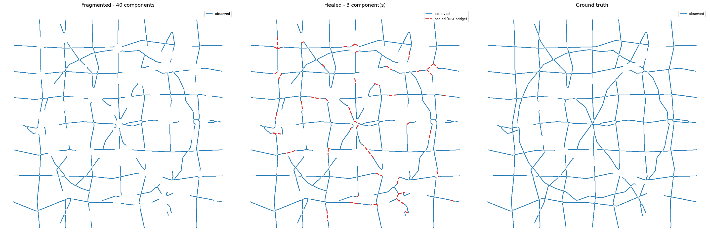

# Route Resilience AI

**Occlusion-Robust Road Extraction & Graph-Theoretic Criticality Analysis for Urban Mobility**

Satellite imagery → road mask → routable graph → criticality → failure simulation → decision support.

Aligned to ISRO/NNRMS downstream utilisation of Sentinel-2, Resourcesat LISS-IV and Cartosat-3.

---

## Status

| Component | State |
|---|---|
| Graph pipeline (skeletonise, heal, criticality, simulation, NER) | implemented and tested |
| FastAPI backend (9 endpoints) and React dashboard (7 sections) | implemented and tested |
| Live metrics on uploaded imagery (attach a ground-truth mask) | implemented and tested |
| U-Net (ResNet-34), DeepLabV3+ (ResNet-50), SegFormer-B3 on DeepGlobe | **trained and evaluated** |
| Fine-tuned SegFormer-B3 (final model) | **trained, evaluated, repeated once** |
| Occlusion-augmentation ablation (U-Net ± occluders) | **run** |
| Occlusion test on the final fine-tuned SegFormer | **run** |
| APLS on real georeferenced imagery (SpaceNet 3 Las Vegas + OSM) | **run** (zero-shot) |
| Indian imagery: ISRO LISS-IV and Sentinel-2 over Hyderabad, with OSM labels | **run** (zero-shot + fine-tuned) |

## Results

DeepGlobe Road Extraction, 4,981 / 747 / 498 train / val / test tiles (disjoint),
Kaggle Tesla T4. Checkpoints are selected on validation clDice. Scores are per-tile
means over full 1024 px tiles with overlap-blended 512 px inference, threshold 0.5,
no test-time augmentation, held-out test split.

### Model comparison (test, n = 498)

| Model | Epochs (best) | IoU | Dice | Precision | Recall | clDice |
|---|---|---|---|---|---|---|
| Classical baseline (Frangi ridge filter) | — | 0.0649 | 0.1192 | 0.0772 | 0.4656 | 0.0998 |
| U-Net (ResNet-34) | 40 (36) | 0.6189 | 0.7530 | 0.6937 | 0.8599 | 0.8434 |
| DeepLabV3+ (ResNet-50) | 50 (46) | 0.6238 | 0.7573 | 0.6942 | 0.8672 | 0.8445 |
| SegFormer-B3 | 36 of 40, time limit (35) | 0.6441 | 0.7732 | 0.7059 | 0.8825 | 0.8562 |
| **SegFormer-B3, fine-tuned (final)** | +30 (21) | **0.6688** | **0.7917** | **0.7645** | 0.8443 | **0.8675** |
| SegFormer-B3, fine-tuned, repeat run | (14) | 0.6635 | 0.7883 | 0.7590 | 0.8436 | 0.8619 |

Validation IoU of the final model is 0.6536 (n = 747); the val–test gap is small
and of the same sign for every model, so the test split is not unusually easy for
one model only.

**Fine-tuning.** The SegFormer predictions were over-thick (precision 0.71 vs
recall 0.88). Fine-tuning from the SegFormer checkpoint with a lower positive-class
weight in the BCE term (8 → 3) and an added Lovász hinge loss (weight 0.5; Berman
et al., 2018, a direct IoU surrogate), for 30 further epochs at learning rate 2e-5, traded some recall for precision and raised test IoU by
+0.025. The repeat run reached 0.6635, so run-to-run variation is about ±0.005.

**Fairness caveat.** Training budgets were not identical (40 / 50 / 36 epochs, and
the fine-tune is an extra training stage), so the comparison is indicative, not a
controlled architecture study.

**Tuned protocol.** With 4-flip test-time augmentation and a threshold chosen on
validation (0.70), U-Net test IoU rises from 0.6189 to 0.6415. This protocol has
not yet been applied to the final model; the table above uses the plain protocol
for every row.

**Pixel accuracy** (about 0.98 for every trained model) is not used to rank models:
roads are about 4 % of pixels, so predicting "no road" everywhere already scores
about 0.96.

The validation IoU logged during training (e.g. 0.474 for U-Net) was measured on one
512 px crop per tile in a single pass. It is not comparable with the figures above.

### Occlusion ablation — the central experiment

Same architecture (U-Net, ResNet-34), same data, same seed, trained **with** and
**without** synthetic occlusion augmentation. Both are tested on the same 498 test
tiles with occluders applied to the image only (the label is never modified).

| Test condition | IoU without occlusion training | IoU with occlusion training | Recall on occluded road, without → with |
|---|---|---|---|
| Unoccluded | **0.6303** | 0.6189 | — |
| Canopy | 0.5930 | 0.5942 | 0.72 → 0.86 |
| Partial (vehicles) | 0.6044 | **0.6492** | 0.80 → 0.93 |
| Clutter | 0.4950 | **0.6385** | 0.55 → 0.89 |

Occlusion training costs 0.011 IoU on clean images and recovers most of the loss
under occlusion: under clutter, IoU rises from 0.495 to 0.639 and recall on hidden
road pixels from 0.55 to 0.89. The model without occlusion training drops under
every condition, which confirms the test harness measures a real degradation.

Caveats: the test occluders come from the same generator as the training occluders
(in-distribution), real canopy has not been tested, and each arm is a single seed.
The occlusion-trained model scoring slightly *above* its own unoccluded control under
partial and clutter is consistent with that in-distribution effect.

### Occlusion test on the final model

Same harness and the same 498 test tiles, applied to the final fine-tuned SegFormer-B3:

| Test condition | U-Net with occlusion training | **SegFormer-B3 (final)** | Recall on occluded road (final) |
|---|---|---|---|
| Unoccluded | 0.6189 | **0.6688** | — |
| Canopy | 0.5942 | **0.6578** (−0.011) | 0.833 |
| Partial (vehicles) | 0.6492 | **0.7029** | 0.904 |
| Clutter | 0.6385 | **0.6952** | 0.855 |

The final model is better than the U-Net under every condition; canopy is the only
occluder that lowers its score, by 0.011 IoU. The same in-distribution caveat applies.

### APLS on real, georeferenced imagery — SpaceNet 3, Las Vegas

`scripts/apls_spacenet.py`: 60 random tiles of SpaceNet 3 (WorldView-3, 0.3 m,
resampled to 0.5 m) with hand-labelled road centrelines, downloaded from the public
SpaceNet bucket. The model was **not** trained on this city or sensor (zero-shot).
Prediction and reference are turned into graphs the same way (skeleton → graph);
APLS node tolerance 8 m.

| Reference | Tiles | APLS (raw graph) | APLS (healed graph) | Relaxed IoU |
|---|---|---|---|---|
| SpaceNet labels | 54 | **0.421** | 0.401 (±0.25) | **0.710** |
| OpenStreetMap | 10 | 0.075 | 0.069 | 0.394 |

* APLS varies strongly per tile (0.00–0.99): residential grids score high, parks and
  campuses with scattered paths score low.
* **Healing did not improve APLS on real data (−0.02).** The model's output is already
  well connected, and the healing thresholds — tuned on the synthetic city — add some
  false connections that APLS penalises. Tuning healing on real imagery is future work.
* The OpenStreetMap row is not reliable: OSM was fetched for only 10 tiles, and in
  these Las Vegas neighbourhoods OSM is missing many residential streets that are
  visible in the image and present in the SpaceNet labels.
* Published SpaceNet 3 systems (~0.6–0.7 APLS) were trained on SpaceNet itself, so
  they are not directly comparable to this zero-shot number.

### Indian imagery — ISRO LISS-IV and Sentinel-2 over Hyderabad

`scripts/prepare_liss4.py` builds a tiled dataset from a satellite scene and labels it
automatically with the OpenStreetMap road network (`src/data/osm_groundtruth.py`);
tiles are split spatially (whole columns, east → test), so no test tile neighbours a
training tile. The final DeepGlobe model is evaluated zero-shot, then fine-tuned on the
training tiles (30 epochs, from the final checkpoint) and evaluated on the test strip.

| Sensor (scene) | Labels | Test tiles | Zero-shot IoU | Fine-tuned IoU | Fine-tuned Dice | Fine-tuned recall | Fine-tuned clDice |
|---|---|---|---|---|---|---|---|
| **LISS-IV**, ResourceSat-2A, 14 Nov 2026, 5 m (Bhoonidhi) — western Hyderabad | OSM roads ≥ 6 m | 54 | 0.138 | **0.254** | 0.396 | 0.552 | 0.417 |
| **Sentinel-2** L2A, 29 Apr 2026, 10 m — central Hyderabad | OSM roads ≥ 8 m | 72 | 0.225 | **0.460** | 0.593 | 0.708 | 0.649 |

* Zero-shot transfer from 0.5 m DeepGlobe to 5–10 m imagery fails, as expected.
  Fine-tuning on 126 (LISS-IV) / 198 (Sentinel-2) tiles from one scene roughly
  **doubles** IoU in both cases, and triples recall on LISS-IV.
* The two rows are **not** a sensor comparison: the Sentinel-2 run labels only roads
  8 m and wider (an easier task), and Sentinel-2 has a true blue band like DeepGlobe,
  while LISS-IV (green, red, NIR) does not.
* OSM labels are incomplete, so part of the low precision is the model finding real
  roads that OSM lacks. One scene per sensor; more scenes are future work.

Topology healing on the synthetic benchmark (`python scripts/run_demo.py`):



---

## Run it

```bash
# 1. backend (CPU only; no CUDA, no GDAL required)
python -m venv .venv && source .venv/bin/activate      # Windows: .venv\Scripts\Activate.ps1
pip install -r requirements.txt
pip install fastapi "uvicorn[standard]" pydantic python-multipart
uvicorn backend.app.main:app --reload --port 8000

# 2. frontend
cd frontend && npm install && npm run dev      # http://localhost:5173
```

Open the app, click **Launch Urban Digital Twin**, then **Run** on the guided
demonstration. That executes the whole pipeline against the real backend in
about two minutes.

Docker:

```bash
docker compose up --build                     # UI on :8080, API on :8000
WITH_TORCH=true docker compose up --build     # include PyTorch for inference
```

Interactive API docs: `http://localhost:8000/docs`.

### Trip Planner (real map, coordinates)

The **Trip Planner (Map)** tab takes A and B as coordinates (typed or clicked on
the map), downloads the OpenStreetMap road network for the area, finds the newest
Sentinel-2 image that is clear *over that area* (checked with the scene's own
cloud mask), runs the fine-tuned Sentinel-2 SegFormer on it, and marks every road:

| colour | meaning |
|---|---|
| green  | **seen** — the model finds road along ≥ 50 % of it (10 m tolerance) |
| amber  | **not seen** — could be a closure, but also tree cover, shadow or a model miss |
| grey   | **not checkable** — narrower than ~8 m (invisible at 10 m) or under cloud |

It also runs the opposite check: road-like lines the satellite model sees where
OSM has **no** road (≥ 200 m long) are shown in purple as *possible unmapped roads*,
for review only, never used for routing.

It then routes A → B, closes each road on the route in turn to find the roads the
trip depends on most, and re-plans under closures, a flood zone or "avoid roads
the satellite could not see". It needs internet the first time an area is used:

```bash
pip install -r requirements-geo.txt              # osmnx, rasterio, geopandas, pystac-client
# put the Sentinel-2 checkpoint at checkpoints/segformer_s2/best.pt
python scripts/plan_trip.py --a 17.4401,78.3489 --b 17.4504,78.3810   # check + pre-cache an area
```

A and B must lie within about 6 km of each other (the model runs on CPU over the
whole box). Results are cached in `data/osm` and `data/plan_cache`, so an area that
was planned once opens instantly and works offline.

---

## Why this is not just a segmentation project

Road segmentation optimises IoU, a pixel-counting metric. A prediction with a
three-pixel break scores almost identically to an unbroken one — but the broken
one yields two disconnected graph components and is useless for routing.

| Stage | Usual approach | Here |
|---|---|---|
| Augmentation | flips, colour jitter | **synthetic occluders** on the image but *not* the label, forcing contextual completion |
| Loss | BCE + Dice | adds **soft-clDice**, comparing skeletons so a break is punished heavily |
| Post-processing | morphological closing | **union–find + MST** bridging with directional and evidence-based cost |
| Output | a mask | a **routable graph** + criticality + resilience + rerouting |

---

## Scientific honesty

This is the constraint the codebase is built around, not a disclaimer bolted on.

**Every road mask carries provenance.** The API cannot return one without it, and
the UI cannot render one without displaying it:

| Mode | Meaning |
|---|---|
| `TRAINED_MODEL` | real inference through a trained checkpoint |
| `CLASSICAL_BASELINE` | Frangi ridge filter — genuine computation, **not** deep learning |
| `DEMO_DATA` | deterministic synthetic city, labelled DEMO throughout |
| `OSM_REFERENCE` | OpenStreetMap rasterisation — ground truth, not a prediction |

**Metrics are never invented.** With no ground truth the API returns
`metrics.available = false` plus the reason, and the UI renders em dashes and
instructions for producing real ground truth. There is no mock data layer in the
frontend: if the backend is down the UI shows an error, not something that looks
like a result.

**Healed road is marked as inferred.** Every bridge is tagged `kind="healed"`,
drawn distinctly, and counted — `healed_length_fraction` reports how much of the
network was inferred rather than observed. Above 20% the UI warns that downstream
criticality is low-confidence.

**Flood scenarios do not predict floods.** They simulate the *closure* of roads in
an area to estimate network consequences. No hydrological model is used.

---

## Architecture

```
frontend/   React 18 + TypeScript + Vite + Tailwind
            canvas network renderer, Recharts, 7 sections
backend/    FastAPI — thin adapter over the scientific core,
            provenance enforced at the schema level
src/        the scientific core: pure numpy / networkx
            graph/ and analytics/ import neither torch nor GDAL
```

Dependencies are tiered so the core installs in under a minute with no CUDA and
no GDAL. That is an architectural rule, not a convenience: it lets the graph
sub-team work while the vision sub-team installs drivers, and keeps the test
suite running in seconds.

---

## The two algorithms worth defending

### Topology healing — union–find + MST

Kruskal over a cost-sorted candidate list adds exactly **(components − 1)**
bridges, provably the minimum that restores connectivity, while union–find
refuses any bridge between fragments already linked by a cheaper path.

```
cost = gap × (1 + w_angle·angular_penalty) × (1 + w_evidence·(1 − evidence))
```

Bridging *through a detected occluder* is cheap; bridging across open ground is
expensive. Bridges above `max_cost` are refused — leaving a real gap beats
inventing a road, because a hallucinated bridge silently corrupts every
downstream centrality number.

**Pure MST healing is wrong on real cities.** A break in a ring road joins two
endpoints of the *same* component, so union–find rejects it and the loop is
destroyed. Connectivity looks perfect while redundancy collapses. Measured
against known ground truth:

| | ground truth | MST only | MST + loop pass |
|---|---|---|---|
| redundancy (α) | 0.132 | 0.018 | 0.075 |
| gatekeeper nodes | 57 | **117** | 52 |
| bridge segments | 70 | **183** | 65 |

MST alone over-reports single points of failure by more than 2×.

### Criticality — betweenness is not enough

Betweenness finds *busy* corridors; articulation points find **gatekeepers**
whose loss disconnects the city. The two rarely coincide: a busy node usually has
alternatives, which is often why it carries traffic. Both are reported, and the
"why is this critical?" explanation is generated from computed statistics —
betweenness rank, OD pairs severed, detour ratio — never from a template.

---

## Resilience Index (primary metric: NER)

**Network Efficiency Resilience.**

```
NER  =  E(G')  /  E(G)

E(H) =  (1 / |P|)  *  SUM over (s,t) in P  of  1 / d_H(s,t),     with 1/inf := 0

G    intact network
G'   network after the failure scenario
P    fixed origin-destination sample, drawn ONCE from G and reused for both terms
d_H  shortest-path length in H, weighted by length_m (or travel_time_s if present)
```

**Range: `0 <= NER <= 1`, by construction.**

| Value | Meaning |
|---|---|
| `1.00` | no sampled route changed; nothing was lost |
| `0.63` | 63% of baseline routing efficiency retained, 37% lost |
| `0.00` | every sampled trip is severed |

### Why it is bounded, and why that is a theorem rather than a clamp

Removing nodes or edges can never create a new path, so for every pair
`d_G'(s,t) >= d_G(s,t)`. Taking reciprocals termwise gives
`1/d_G' <= 1/d_G`, hence `E(G') <= E(G)` and `NER <= 1`. Every term is
non-negative, so `NER >= 0`. No clamping is applied; the only guard in the code
is against floating-point round-off at the 1e-12 level.

Three further properties follow, and each has a regression test:

- **Identity** — an empty scenario scores exactly `1.0`.
- **Monotonicity** — for nested removals `G'' ⊂ G' ⊂ G`, `NER(G'') <= NER(G')`.
  More damage can never raise the score.
- **Totality** — a severed pair contributes `0` rather than infinity, so
  disconnection *lowers* the score instead of making it undefined. Detour and
  disconnection are captured by one number.

### Two secondary readings that are NOT the index

Both are reported for completeness and are deliberately kept out of the primary
field.

**Literal ASPL ratio** (`resilience_index_literal_aspl`) — the project brief's
definition, `ASPL_baseline / ASPL_perturbed`. Mean shortest path length becomes
infinite the moment one OD pair disconnects, so this reads exactly `0.00` for
almost every realistic scenario and cannot rank them. Flagged with
`literal_aspl_is_degenerate`.

**Connected-only ASPL ratio** (`diagnostic_aspl_ratio_connected_only`) —
averages over surviving pairs only. When most trips are severed the survivors
are disproportionately *short* ones, so mean path length falls and the ratio
climbs **above 1**, which would read as a collapsed network improving. Measured
example: a chain network shattered into fragments, 92% of trips impossible,
yields `5.33`. It carries `diagnostic_is_resilience_score: false` and
`diagnostic_survivorship_biased: true`. It is kept because it is a useful
diagnostic of *which* trips survived, and removed from the primary slot because
it is unbounded and non-monotone.

---

## API

| Endpoint | Purpose |
|---|---|
| `GET /api/health` | model status, capabilities, provenance |
| `POST /api/imagery/demo` | deterministic synthetic study area |
| `POST /api/imagery/upload` | GeoTIFF or image upload |
| `POST /api/imagery/{id}/ground-truth` | attach a reference mask (e.g. DeepGlobe `*_mask.png`) → real metrics for that scene |
| `POST /api/extract-roads` | segmentation (mode explicit, never implied) |
| `POST /api/build-graph` | skeletonise + heal + statistics + GeoJSON |
| `POST /api/criticality` | betweenness, gatekeepers, explanations |
| `POST /api/simulate-failure` | scenario, impact, resilience |
| `POST /api/route` | baseline vs disrupted routing |
| `GET /api/models` | checkpoints on the server (DeepGlobe / Sentinel-2 / LISS-IV), chosen per extraction with `model` |
| `POST /api/plan` | trip planner: A/B lat/lon → OSM roads, latest clear Sentinel-2, per-road satellite check, route, critical roads |
| `POST /api/plan/{id}/reroute` | same trip under closed roads / a flood circle / avoiding roads the satellite did not see |
| `POST /api/route/what-if` | trip A→B: closes each junction on the route, ranks the weakest, returns the alternate route or "cut off" |

---

## Training

```bash
pip install -r requirements-dl.txt        # read the header: install torch first
python scripts/prepare_deepglobe.py --src data/external/deepglobe --out data/processed
python -m src.models.train --model unet_r34          --data data/processed
python -m src.models.train --model deeplabv3plus_r50 --data data/processed
python -m src.models.train --model segformer_b3      --data data/processed
python -m src.models.train --model segformer_b3      --data data/processed --no-occlusion
python scripts/run_benchmark.py --checkpoints checkpoints/*/best.pt --data data/processed/test
```

All runs reported under Results used the Kaggle wrapper `scripts/kaggle_train.py`
(see `docs/KAGGLE_TRAINING.md`). The final model was fine-tuned with
`--init-from <segformer best.pt> --pos-weight 3 --lovasz-weight 0.5 --lr 2e-5 --epochs 30`.
Real-imagery experiments (each ran as one Kaggle notebook; the executed notebooks, with their full logs, are in [`notebooks/`](notebooks/)):

```bash
# APLS on SpaceNet 3 Las Vegas (+ OpenStreetMap), zero-shot
python scripts/apls_spacenet.py --checkpoint best.pt --out outputs/apls --n-tiles 60 --osm
# LISS-IV scene from Bhoonidhi (BAND2/3/4.tif) -> tiles + OSM labels, then train/evaluate as usual
python scripts/prepare_liss4.py --scene <scene folder> --center 17.44,78.30 --out data/liss4
# Sentinel-2 (no login): download a cloud-free window, then the same preparation
python scripts/fetch_sentinel2.py --center 17.385,78.487 --out data/s2/scene.tif
python scripts/prepare_liss4.py --scene data/s2/scene.tif --sensor sentinel2 --upsample 4 --min-width-m 8 --out data/s2_tiles
```

`scripts/ensemble_eval.py` scores multiple checkpoints with test-time augmentation
and a validation-chosen threshold.

Baselines first: without a U-Net trained under identical conditions, "the
transformer is better" is an assertion rather than a measurement. Checkpoints are
selected on **clDice, not IoU** — high IoU with low clDice means dotted-line
roads, pixel-accurate and useless for routing.

The strongest single experiment is the last training command: identical
architecture ± synthetic occluders, compared on `recall_occluded`. It isolates one
variable and tests the project's central claim directly.

Drop a checkpoint in `checkpoints/` and the backend finds it automatically;
`/api/health` then reports `TRAINED_MODEL` and extraction switches to real
inference. Nothing else changes.

---

## Testing

```bash
python tests/run_tests_nopytest.py               # 49 scientific core tests
python backend/tests/test_api_e2e.py             # 44 API + sanity tests
python backend/tests/test_contract.py            # 89 frontend/backend contract checks
python backend/tests/test_resilience_metric.py   # 27 resilience-metric properties
python backend/tests/test_deployment.py          # 13 offline-deployment checks   (needs PyTorch)
python backend/tests/test_trained_pipeline.py    # 25 trained-pipeline checks     (needs PyTorch)
python backend/tests/test_ground_truth_upload.py # 11 ground-truth upload checks
python backend/tests/test_trip_what_if.py        # 13 image-planner trip checks
python backend/tests/test_model_selection.py     # 12 model-selection checks       (needs PyTorch)
python tests/test_route_planner.py               # 28 trip-planner core checks     (needs geo stack)
python backend/tests/test_trip_planner_api.py    # 40 trip-planner API checks (network replaced by stand-ins)
cd frontend && npx tsc --noEmit && npm run build
```

The contract suite checks that every field the React app reads actually exists in
the backend response — the class of bug where the API is perfectly valid and the
UI silently renders `undefined`.

Sanity properties asserted: a no-op scenario causes zero disruption; removing a
gatekeeper disconnects the network; healing adds exactly (components − 1) bridges;
targeted damage exceeds random damage.

---

## Limitations

1. **Healing can hallucinate.** Every bridge is an inference. `max_cost` bounds the
   risk but does not remove it; healed segments are labelled and counted.
2. **Betweenness assumes shortest-path routing**, no capacity limits, uniform demand.
3. **Travel time uses one assumed free-flow speed**, disclosed in every routing
   response, because road class is not available from imagery alone.
4. **Flood scenarios are geometric, not hydrological.**
5. **The synthetic city tests the pipeline, not accuracy.** Segmentation numbers must
   come from held-out real data scored against OSM.
6. **OSM ground truth has a temporal mismatch** with image acquisition dates.
7. **Exact betweenness is O(V·E).** Above the configured node count the API estimates
   from pivots and reports that it did so.
8. **Domain shift.** Zero-shot on 5–10 m imagery the DeepGlobe model scores IoU
   0.14–0.23; fine-tuning on one Hyderabad scene doubles it (0.25 LISS-IV, 0.46
   Sentinel-2) but it remains far below 0.67 at 0.5 m. One scene per sensor.
9. **Healing gives no APLS gain on real imagery** (SpaceNet: −0.02); its thresholds
   were tuned on the synthetic city. APLS on real data is zero-shot, one city.
10. **Occlusion robustness is measured with synthetic occluders** from the same
    generator used in training; real canopy and shadow are untested.
11. **OpenStreetMap is a noisy reference**: it misses residential streets in places
    (seen in Las Vegas) and has no road widths, which are assumed per road class.
12. **The Trip Planner does not detect closures.** "Not seen" is evidence, not proof:
    one image cannot tell a closed road from a road under trees. Detecting real
    closures needs a before/after image pair (change detection) and is future work.
    Travel time is length ÷ a typical speed per road class; one-way rules and live
    traffic are not modelled. The Sentinel-2 model reaches IoU 0.46 on held-out
    Hyderabad tiles and has only been fine-tuned on Hyderabad.

---

## Docs

- `docs/ARCHITECTURE.md` — layers, data flow, design decisions
- `docs/GRAPH_THEORY.md` — healing, centrality and resilience mathematics
- `docs/DEMO.md` — faculty demonstration script
- `docs/KAGGLE_TRAINING.md` — reproducible training procedure
- `docs/OCCLUSION_HARNESS.md` — occluder correction record (v1 superseded)
- `docs/INTERFACE_CONTRACT.md` — the seam between the two sub-teams
- `docs/DATA_ACQUISITION.md` — datasets and sensor gotchas
